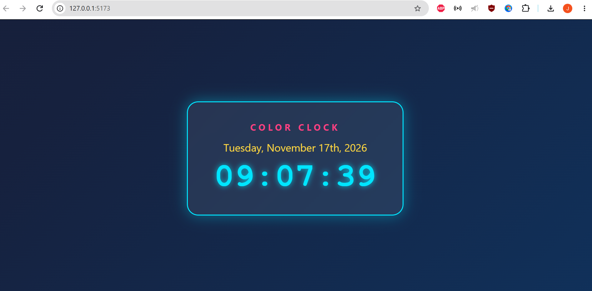

# Color Clock

A colorful digital clock built with **React**, **Vite**, and **date-fns**. It shows the current date and time and updates every second.

## Prerequisites

- [Node.js](https://nodejs.org/) (v18 or newer) and npm

## Run it locally

```bash
# 1. Clone the repository
git clone https://github.com/kuriajosh777/Dynamic-Color-Clock-.git
cd Dynamic-Color-Clock-


# 2. Install dependencies
npm install

# 3. Start the development server
npm run dev
```

Open the local URL shown in the terminal (usually http://localhost:5173).

## Tech used

- React (JSX components, `useState`, `useEffect`)
- Vite (project setup and dev server)
- date-fns 2.30.0 (date and time formatting)

## Project structure

```
color-clock/
├── index.html
├── package.json
├── vite.config.js
└── src/
    ├── main.jsx   # app entry point
    ├── App.jsx    # clock component
    ├── App.css    # clock styles
    └── index.css  # global styles
```

## Screenshot


